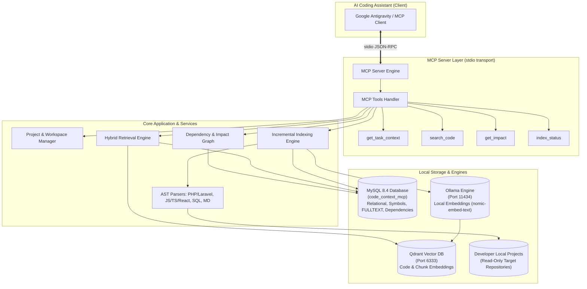

# System Architecture: code-context-mcp

## 1. High-Level Architecture Overview

`code-context-mcp` is an independent, local-first Model Context Protocol (MCP) server and Retrieval-Augmented Generation (RAG) platform. It allows AI coding assistants (like Google Antigravity) to query multi-project local codebases with deep semantic understanding, AST-level symbol extraction, dependency analysis, and curated project memory.

---

## 2. Component Breakdown

### 2.1. MCP Server Layer (`src/mcp/`)
- Implemented using the official `@modelcontextprotocol/sdk`.
- Communicates via `StdioServerTransport` for standard input/output streaming.
- Registers standard MCP tools with strict Zod input schemas and comprehensive documentation.
- Validates all requests against registered projects and active workspaces to prevent unauthorized cross-project data leakage.

### 2.2. Project & Workspace Management (`src/projects/`)
- Manages registration of multiple local projects (e.g. PHP/Laravel monoliths, React frontends, Node backends).
- Records root absolute paths, language settings, framework types, and custom exclusions.
- Discovers and isolates project workspaces (Git branches, specific commit hashes, and local uncommitted working directories).
- Strictly prevents path traversal attacks outside project roots.

### 2.3. Code Parsing & Chunking Engine (`src/indexer/`)
- **File Scanner**: Traverses project files, applying `.gitignore`, user ignore patterns, and built-in secret protections (e.g. `.env`, `.pem`, private keys).
- **AST Parsing Engine**:
  - **PHP / Laravel (`src/parsers/php.ts`)**: Uses `php-parser` AST to extract namespaces, classes, methods, traits, interfaces, models, controllers, middleware, requests, Laravel routes (`Route::get`, `post`, etc.), migrations (`Schema::create`), and Eloquent relationships (`hasMany`, `belongsTo`, `belongsToMany`).
  - **JS / TS / React (`src/parsers/javascript.ts`)**: Uses `@babel/parser` and `@babel/traverse` to extract functions, classes, React components (functional & class), hooks (`useState`, `useEffect`, custom hooks), imports, exports, API calls (`fetch`, `axios`), and routes.
  - **SQL & Migrations (`src/parsers/sql.ts`)**: Extracts schema tables, columns, constraints, and foreign key relations from migration files.
  - **Markdown & Curated Memory (`src/parsers/markdown.ts`)**: Parses `.ai/` directory docs, extracting architecture notes, business rules, decisions, coding standards, and known issues into structured memory blocks.
- **Intelligent Chunking (`src/indexer/chunker.ts`)**:
  - Chunks code along natural AST boundaries (class declarations, individual methods, components, documentation sections).
  - Bounded size capping prevents token overflow while maintaining line number anchors and file references.
  - Calculates SHA-256 hashes per chunk to avoid redundant embedding generations.

### 2.4. Storage & Persistence Layer
- **MySQL 8.4 (`src/db/`)**:
  - Sole relational database engine.
  - Houses normalized tables: projects, workspaces, indexed files, AST symbols, dependencies, application routes, parsed database schemas, dependency graph edges, curated project memory, indexing jobs, and error logs.
  - Executes MySQL FULLTEXT searches over chunk contents and symbol names.
- **Qdrant Vector Database (`src/vectors/`)**:
  - Stores high-dimensional vector embeddings for code chunks.
  - Enforces workspace isolation by filtering payloads on `project_id` and `workspace_id`.
  - Performs nearest-neighbor cosine similarity queries for semantic retrieval.
- **Ollama Client (`src/embeddings/`)**:
  - Connects to local Ollama instance (`http://127.0.0.1:11434`).
  - Generates dense vector embeddings using configured models (e.g., `nomic-embed-text`, 768 dimensions).
  - Employs batching and concurrency throttling.

### 2.5. Hybrid RAG Search Engine (`src/search/`)
Combines multiple search modalities using weighted reciprocal rank fusion (RRF):
1. **Exact Symbol / Identifier Matching**: Direct indexed lookup for class names, method signatures, and functions.
2. **File Path Matching**: Instant retrieval for specific file paths or directory subtrees.
3. **MySQL FULLTEXT Keyword Search**: Natural language full-text search against source content and symbol signatures.
4. **Qdrant Vector Semantic Search**: Captures high-level intent, conceptual questions, and natural language queries.
5. **Curated Memory Matching**: Pulls relevant `.ai/` business rules, coding standards, and architectural decisions.
6. **Dependency Graph Expansion**: Injects related controllers, models, and caller/callee context into the final retrieved context.

### 2.6. Dependency Graph & Impact Engine (`src/impact/`)
- Builds a bi-directional directed graph of project components:
  - Route -> Controller -> Action
  - Controller -> Service / Model
  - Model -> Database Table / Relationship
  - Component -> Imported Component / Hook
  - Test -> Implementation target
- Computes impact radius when a file, model, or method is modified, distinguishing confirmed AST dependencies from inferred keyword references.

---

## 3. Security, Privacy & Isolation

1. **Local-First Isolation**:
   - Source code, database rows, vector indexes, and embeddings never leave the developer's workstation.
   - No external SaaS dependencies or mandatory cloud APIs.
2. **Strict Project Isolation**:
   - All queries filter by `project_id` and `workspace_id`.
   - Foreign key constraints ensure no data bleed across projects.
3. **Read-Only Codebase Guarantee**:
   - The indexing engine opens files exclusively with read flags.
   - File modification or script execution in registered projects is strictly prohibited.
4. **Secret Blacklist**:
   - Automatically skips `.env`, `.env.*`, `*.pem`, `*.key`, `id_rsa`, certificates, tokens, and binary files.

