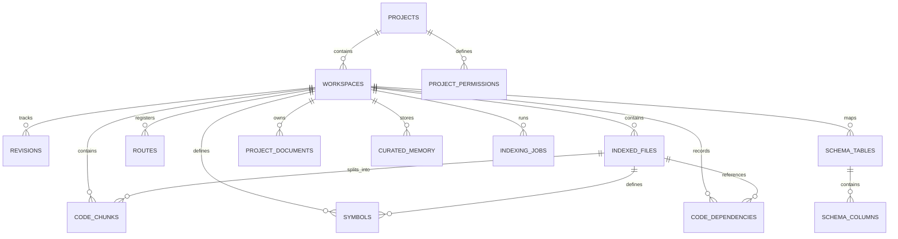

# MySQL Database Schema Documentation

## Database Information
- **RDBMS Engine**: MySQL 8.4 Community Server
- **Default Database**: `code_context_mcp`
- **Character Set**: `utf8mb4`
- **Collation**: `utf8mb4_unicode_ci`
- **Engine**: InnoDB (supporting transactions, row-level locking, foreign keys, and FULLTEXT indexes)

---

## Entity Relationship Overview

---

## Detailed Table Specifications

### 1. `migrations`
Tracks executed schema migrations to ensure version consistency.
- `id` INT UNSIGNED AUTO_INCREMENT PRIMARY KEY
- `name` VARCHAR(255) NOT NULL UNIQUE
- `batch` INT UNSIGNED NOT NULL
- `executed_at` DATETIME NOT NULL DEFAULT CURRENT_TIMESTAMP

### 2. `projects`
Stores metadata about registered developer codebases.
- `id` VARCHAR(64) PRIMARY KEY (Slug or UUID)
- `name` VARCHAR(255) NOT NULL
- `root_path` VARCHAR(1024) NOT NULL
- `description` TEXT NULL
- `primary_language` VARCHAR(64) NOT NULL DEFAULT 'auto'
- `framework` VARCHAR(64) NULL (e.g. 'laravel', 'react', 'node', 'generic')
- `default_branch` VARCHAR(128) NOT NULL DEFAULT 'main'
- `config` JSON NULL (Custom ignore rules, inclusion patterns, parser overrides)
- `created_at` DATETIME NOT NULL DEFAULT CURRENT_TIMESTAMP
- `updated_at` DATETIME NOT NULL DEFAULT CURRENT_TIMESTAMP ON UPDATE CURRENT_TIMESTAMP
- **Indexes**: `UNIQUE KEY uq_project_path (root_path(255))`

### 3. `workspaces`
Represents an isolated working environment (Git branch, commit revision, or uncommitted local workdir).
- `id` VARCHAR(64) PRIMARY KEY
- `project_id` VARCHAR(64) NOT NULL
- `name` VARCHAR(255) NOT NULL (e.g., 'main', 'feature/login', 'working-copy')
- `type` ENUM('branch', 'working_copy', 'commit_snapshot') NOT NULL DEFAULT 'working_copy'
- `git_branch` VARCHAR(255) NULL
- `git_commit_hash` VARCHAR(64) NULL
- `is_active` TINYINT(1) NOT NULL DEFAULT 1
- `created_at` DATETIME NOT NULL DEFAULT CURRENT_TIMESTAMP
- `updated_at` DATETIME NOT NULL DEFAULT CURRENT_TIMESTAMP ON UPDATE CURRENT_TIMESTAMP
- **Foreign Keys**: `CONSTRAINT fk_workspaces_project FOREIGN KEY (project_id) REFERENCES projects(id) ON DELETE CASCADE`
- **Indexes**: `UNIQUE KEY uq_project_workspace (project_id, name)`

### 4. `indexed_files`
Tracks individual source files within a workspace.
- `id` BIGINT UNSIGNED AUTO_INCREMENT PRIMARY KEY
- `project_id` VARCHAR(64) NOT NULL
- `workspace_id` VARCHAR(64) NOT NULL
- `relative_path` VARCHAR(1024) NOT NULL
- `file_extension` VARCHAR(32) NOT NULL
- `language` VARCHAR(64) NOT NULL
- `content_hash` CHAR(64) NOT NULL (SHA-256)
- `size_bytes` BIGINT UNSIGNED NOT NULL DEFAULT 0
- `is_uncommitted` TINYINT(1) NOT NULL DEFAULT 0
- `is_deleted` TINYINT(1) NOT NULL DEFAULT 0
- `last_indexed_at` DATETIME NOT NULL DEFAULT CURRENT_TIMESTAMP
- **Foreign Keys**:
  - `CONSTRAINT fk_files_project FOREIGN KEY (project_id) REFERENCES projects(id) ON DELETE CASCADE`
  - `CONSTRAINT fk_files_workspace FOREIGN KEY (workspace_id) REFERENCES workspaces(id) ON DELETE CASCADE`
- **Indexes**:
  - `UNIQUE KEY uq_workspace_file (workspace_id, relative_path(255))`
  - `KEY idx_files_hash (content_hash)`

### 5. `code_chunks`
Stores AST-segmented code blocks for full-text search, line referencing, and vector linkage.
- `id` BIGINT UNSIGNED AUTO_INCREMENT PRIMARY KEY
- `chunk_id` VARCHAR(128) NOT NULL (Deterministic Hash or UUID)
- `project_id` VARCHAR(64) NOT NULL
- `workspace_id` VARCHAR(64) NOT NULL
- `file_id` BIGINT UNSIGNED NOT NULL
- `relative_path` VARCHAR(1024) NOT NULL
- `symbol_name` VARCHAR(255) NULL
- `symbol_type` VARCHAR(64) NOT NULL (e.g. 'class', 'method', 'function', 'component', 'doc_section', 'block')
- `parent_symbol` VARCHAR(255) NULL
- `start_line` INT UNSIGNED NOT NULL
- `end_line` INT UNSIGNED NOT NULL
- `content` MEDIUMTEXT NOT NULL
- `content_hash` CHAR(64) NOT NULL
- `language` VARCHAR(64) NOT NULL
- `qdrant_point_id` VARCHAR(64) NULL (UUID matching Qdrant vector)
- `embedding_status` ENUM('pending', 'synced', 'failed') NOT NULL DEFAULT 'pending'
- `created_at` DATETIME NOT NULL DEFAULT CURRENT_TIMESTAMP
- **Foreign Keys**:
  - `CONSTRAINT fk_chunks_file FOREIGN KEY (file_id) REFERENCES indexed_files(id) ON DELETE CASCADE`
- **Indexes**:
  - `UNIQUE KEY uq_chunk_id (chunk_id)`
  - `KEY idx_chunks_project_workspace (project_id, workspace_id)`
  - `FULLTEXT KEY ft_chunk_content (content, symbol_name)`

### 6. `symbols`
Normalized code definitions (classes, interfaces, methods, functions, components, hooks).
- `id` BIGINT UNSIGNED AUTO_INCREMENT PRIMARY KEY
- `project_id` VARCHAR(64) NOT NULL
- `workspace_id` VARCHAR(64) NOT NULL
- `file_id` BIGINT UNSIGNED NOT NULL
- `name` VARCHAR(255) NOT NULL
- `kind` VARCHAR(64) NOT NULL ('class', 'interface', 'trait', 'method', 'function', 'component', 'hook', 'route', 'model')
- `namespace_or_module` VARCHAR(255) NULL
- `parent_symbol` VARCHAR(255) NULL
- `start_line` INT UNSIGNED NOT NULL
- `end_line` INT UNSIGNED NOT NULL
- `signature` TEXT NULL
- `docstring` TEXT NULL
- `visibility` VARCHAR(32) NULL ('public', 'protected', 'private', 'export')
- `created_at` DATETIME NOT NULL DEFAULT CURRENT_TIMESTAMP
- **Indexes**:
  - `KEY idx_symbols_lookup (project_id, workspace_id, name)`
  - `KEY idx_symbols_kind (kind)`

### 7. `code_dependencies`
Tracks imports, caller-callee linkages, and module interactions.
- `id` BIGINT UNSIGNED AUTO_INCREMENT PRIMARY KEY
- `project_id` VARCHAR(64) NOT NULL
- `workspace_id` VARCHAR(64) NOT NULL
- `source_file_id` BIGINT UNSIGNED NOT NULL
- `target_module` VARCHAR(512) NOT NULL
- `target_file_id` BIGINT UNSIGNED NULL
- `symbol_name` VARCHAR(255) NULL
- `dependency_type` VARCHAR(64) NOT NULL ('import', 'extends', 'implements', 'uses_trait', 'calls', 'renders_component', 'service_inject')
- `created_at` DATETIME NOT NULL DEFAULT CURRENT_TIMESTAMP
- **Indexes**:
  - `KEY idx_dep_source (source_file_id)`
  - `KEY idx_dep_target (project_id, target_module(255))`

### 8. `routes`
Application routing definitions parsed from code (Laravel routes, Express routes, React routes).
- `id` BIGINT UNSIGNED AUTO_INCREMENT PRIMARY KEY
- `project_id` VARCHAR(64) NOT NULL
- `workspace_id` VARCHAR(64) NOT NULL
- `file_id` BIGINT UNSIGNED NOT NULL
- `http_method` VARCHAR(16) NOT NULL ('GET', 'POST', 'PUT', 'DELETE', 'PATCH', 'ANY')
- `uri_pattern` VARCHAR(512) NOT NULL
- `route_name` VARCHAR(255) NULL
- `controller` VARCHAR(255) NULL
- `action` VARCHAR(128) NULL
- `middleware` JSON NULL
- `line_number` INT UNSIGNED NOT NULL
- **Indexes**:
  - `KEY idx_routes_lookup (project_id, workspace_id, uri_pattern(255))`

### 9. `schema_tables` & `schema_columns`
Represents database tables and columns parsed from migrations and schema files.
- **`schema_tables`**:
  - `id` BIGINT UNSIGNED AUTO_INCREMENT PRIMARY KEY
  - `project_id` VARCHAR(64) NOT NULL
  - `workspace_id` VARCHAR(64) NOT NULL
  - `table_name` VARCHAR(128) NOT NULL
  - `model_class` VARCHAR(255) NULL
  - `migration_file` VARCHAR(512) NULL
  - **Indexes**: `UNIQUE KEY uq_schema_table (project_id, workspace_id, table_name)`
- **`schema_columns`**:
  - `id` BIGINT UNSIGNED AUTO_INCREMENT PRIMARY KEY
  - `table_id` BIGINT UNSIGNED NOT NULL
  - `column_name` VARCHAR(128) NOT NULL
  - `data_type` VARCHAR(64) NOT NULL
  - `is_nullable` TINYINT(1) NOT NULL DEFAULT 1
  - `is_primary_key` TINYINT(1) NOT NULL DEFAULT 0
  - `foreign_table` VARCHAR(128) NULL
  - `foreign_column` VARCHAR(128) NULL
  - **Foreign Keys**: `CONSTRAINT fk_cols_table FOREIGN KEY (table_id) REFERENCES schema_tables(id) ON DELETE CASCADE`

### 10. `project_documents` & `curated_memory`
Stores knowledge indexed from the `.ai/` directory.
- **`project_documents`**:
  - `id` BIGINT UNSIGNED AUTO_INCREMENT PRIMARY KEY
  - `project_id` VARCHAR(64) NOT NULL
  - `workspace_id` VARCHAR(64) NOT NULL
  - `doc_type` VARCHAR(64) NOT NULL ('architecture', 'business_rules', 'coding_standards', 'decisions', 'known_issues', 'general')
  - `file_path` VARCHAR(512) NOT NULL
  - `title` VARCHAR(255) NOT NULL
  - `content` MEDIUMTEXT NOT NULL
  - `content_hash` CHAR(64) NOT NULL
  - `last_indexed_at` DATETIME NOT NULL DEFAULT CURRENT_TIMESTAMP
- **`curated_memory`**:
  - `id` BIGINT UNSIGNED AUTO_INCREMENT PRIMARY KEY
  - `project_id` VARCHAR(64) NOT NULL
  - `workspace_id` VARCHAR(64) NOT NULL
  - `category` VARCHAR(64) NOT NULL ('business_rule', 'coding_standard', 'architecture_decision', 'known_gotcha')
  - `topic` VARCHAR(255) NOT NULL
  - `rule_statement` TEXT NOT NULL
  - `status` ENUM('approved', 'proposed', 'deprecated') NOT NULL DEFAULT 'approved'
  - `source_file` VARCHAR(512) NULL
  - `created_at` DATETIME NOT NULL DEFAULT CURRENT_TIMESTAMP
  - **Indexes**: `FULLTEXT KEY ft_memory_text (topic, rule_statement)`

### 11. `indexing_jobs` & `error_logs`
Tracks indexing lifecycle, diagnostics, and failure recovery.
- **`indexing_jobs`**:
  - `id` BIGINT UNSIGNED AUTO_INCREMENT PRIMARY KEY
  - `project_id` VARCHAR(64) NOT NULL
  - `workspace_id` VARCHAR(64) NOT NULL
  - `job_type` ENUM('full', 'incremental', 'watch_event') NOT NULL
  - `status` ENUM('running', 'completed', 'failed', 'interrupted') NOT NULL DEFAULT 'running'
  - `files_scanned` INT UNSIGNED NOT NULL DEFAULT 0
  - `files_indexed` INT UNSIGNED NOT NULL DEFAULT 0
  - `chunks_created` INT UNSIGNED NOT NULL DEFAULT 0
  - `vectors_generated` INT UNSIGNED NOT NULL DEFAULT 0
  - `started_at` DATETIME NOT NULL DEFAULT CURRENT_TIMESTAMP
  - `completed_at` DATETIME NULL
  - `error_message` TEXT NULL
- **`error_logs`**:
  - `id` BIGINT UNSIGNED AUTO_INCREMENT PRIMARY KEY
  - `project_id` VARCHAR(64) NULL
  - `file_path` VARCHAR(1024) NULL
  - `error_type` VARCHAR(64) NOT NULL
  - `message` TEXT NOT NULL
  - `stack_trace` TEXT NULL
  - `created_at` DATETIME NOT NULL DEFAULT CURRENT_TIMESTAMP

