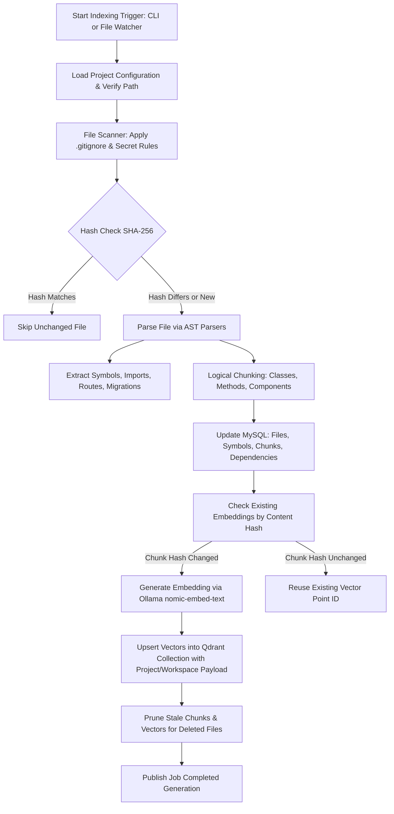
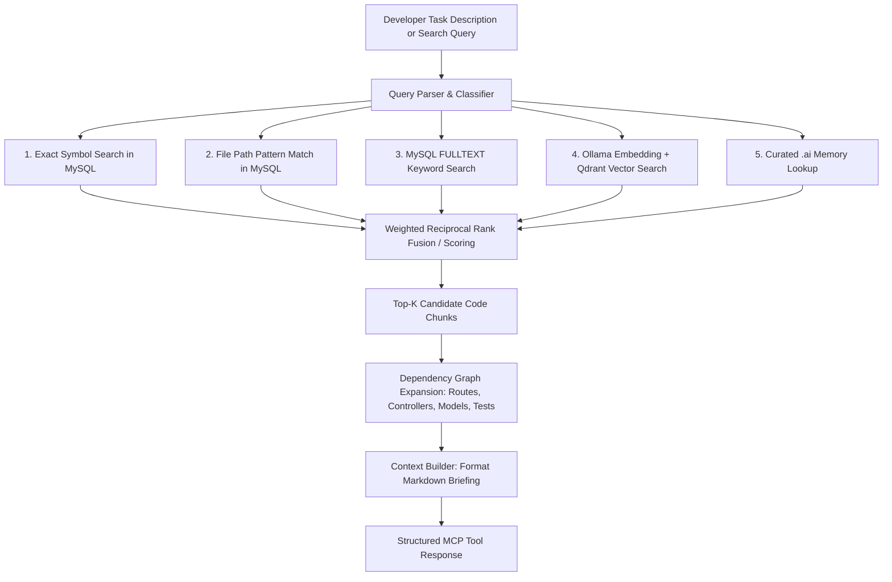

# End-to-End RAG & Retrieval Flow

This document details the lifecycle of source code processing, vector embedding, storage, and contextual retrieval in `code-context-mcp`.

---

## 1. Complete Indexing Pipeline



### Step 1: File Discovery & Safety Filtering
- Resolves the absolute path of the target project workspace.
- Evaluates `.gitignore` using the `ignore` library.
- Applies strict safety filters:
  - Excludes `node_modules`, `vendor`, `.git`, `dist`, `build`, `storage/framework`.
  - Excludes secrets: `.env`, `.env.*`, `*.pem`, `*.key`, `*.pfx`, `id_rsa`, `id_ed25519`.
  - Excludes binaries: images, archives, compiled binaries (`.exe`, `.dll`, `.so`).

### Step 2: Content Hash & Change Detection
- Reads each valid file and computes its SHA-256 content hash.
- Compares against the `indexed_files` record in MySQL for that `(workspace_id, relative_path)`.
- If identical, the file is skipped during incremental runs.
- Identifies added, modified, renamed, and deleted files.

### Step 3: AST Parsing & Semantic Extraction
- Parses the file with the appropriate AST engine:
  - **PHP / Laravel**: Identifies classes, namespaces, methods, docblocks, Eloquent models, relationships, controllers, routes, and migrations.
  - **JavaScript / TypeScript / React**: Identifies functional components, class components, hooks, exported functions, interfaces, type aliases, imports, and route definitions.
  - **Markdown / `.ai/`**: Extracts curated business rules, architecture decisions, and coding standards.
  - **SQL**: Extracts schema table definitions and column definitions.
- Fallback parser: When AST fails due to syntax errors or unsupported languages, graceful fallback chunks the file by logical line blocks or functions without crashing.

### Step 4: Logical Chunking
- Segments code into discrete, meaningful chunks:
  - Class declarations with class-level docblocks.
  - Individual method bodies with parameter types and return types.
  - Standalone functions and React components.
  - Documentation sections (by `#` and `##` headings).
- Each chunk preserves `start_line` and `end_line` offsets so AI coding assistants can navigate precisely to line numbers.

### Step 5: MySQL Relational Synchronization
- Persists extracted symbols to the `symbols` table.
- Persists chunk content and metadata to `code_chunks`.
- Maintains FULLTEXT indexes on chunk content and symbol names for fast lexical queries.

### Step 6: Ollama Embeddings & Qdrant Upsert
- For new or modified chunks, requests 768-dimensional embeddings from local Ollama (`nomic-embed-text`).
- Embeddings are sent in batches to maximize throughput.
- Inserts or updates vectors in Qdrant with payload:
  ```json
  {
    "chunk_id": "c7a8b9...",
    "project_id": "engineering-crm",
    "workspace_id": "working-copy",
    "relative_path": "app/Http/Controllers/ProjectController.php",
    "symbol_name": "store",
    "symbol_type": "method",
    "language": "php",
    "start_line": 45,
    "end_line": 82
  }
  ```

### Step 7: Stale Vector Cleanup
- When files are deleted or edited, outdated chunks and their associated Qdrant points are identified and pruned from both MySQL and Qdrant.

---

## 2. RAG Retrieval Pipeline (`get_task_context` & `search_code`)



### Fusion & Scoring Strategy
Results from lexical, exact, and semantic sources are normalized:
$$\text{Score} = w_{\text{exact}} \cdot S_{\text{exact}} + w_{\text{fulltext}} \cdot S_{\text{fulltext}} + w_{\text{vector}} \cdot S_{\text{vector}} + w_{\text{memory}} \cdot S_{\text{memory}}$$

- **Exact Identifier Match**: Prioritizes exact class/function/method name hits.
- **FULLTEXT Match**: Captures exact variable names, error messages, and keyword phrases.
- **Vector Match**: Captures semantic intent (e.g., "handle user signup" finds `RegisterController::create`).
- **Curated Memory**: Surfaces mandatory business rules or architectural guidelines relevant to the topic.
- **Dependency Expansion**: Pulls in related migrations, models, and tests so the AI assistant sees the full picture before proposing edits.
